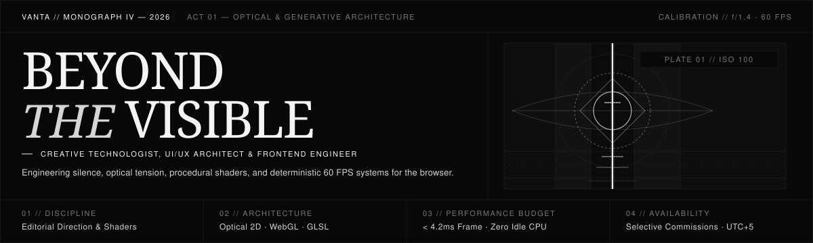
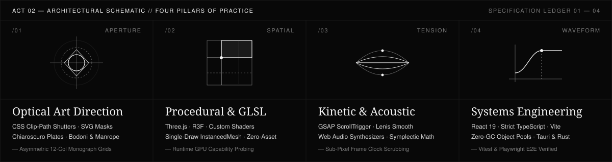
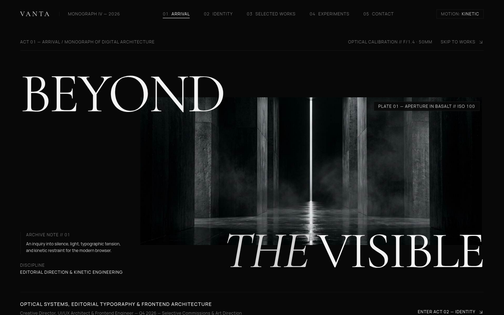
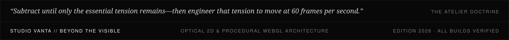

  

 

## 01 // ARCHITECTURAL THESIS

Most digital products are assembled from interchangeable templates—loud, hurried, and forgotten the moment the tab closes. My practice operates at the intersection of **editorial art direction**, **mathematical procedural generation**, **optical 2D/3D rendering**, and **low-latency frontend architecture**.

Whether engineering a zero-asset WebGL film with procedural GLSL shaders and synthesized acoustics, or a strictly 2D chiaroscuro print monograph driven by CSS shutter apertures and damped SVG physics, every system is built around a single constraint: **uncompromising visual gravity at a deterministic 60 FPS**.

 

  

 

---

## 02 // SELECTED MONOGRAPHS & PRODUCTION SYSTEMS

### I. PROJECT VANTA — Beyond the Visible
**An experimental dark editorial monograph and 2D optical laboratory engineered without WebGL overhead.**

| Specification | Detail |
| :--- | :--- |
| **Repository** | [github.com/islomf2010-dot/portfolio](https://github.com/islomf2010-dot/portfolio) |
| **Architecture** | `React 19` · `TypeScript` · `GSAP ScrollTrigger` · `Lenis` · `CSS Clip-Path Shutters` · `SVG Harmonics` |
| **Optical Engineering** | Replaces heavy 3D canvases with medium-format AVIF/WebP chiaroscuro plates, dual-curtain CSS aperture reveals, a 5-frame automotive contact-sheet filmstrip, and four live 2D optical instruments (variable axis shear, zero-idle damped SVG strings, 7-band slit-scan refraction, and choreographed shutter prototypes). |

---

### II. AFTERLIGHT — The World Between Frames
**An interactive cinematic WebGL film in six acts, rendered within a single WebGL context with zero downloaded 3D or audio assets.**

| Specification | Detail |
| :--- | :--- |
| **Live Exhibition** | [islomf2010-dot.github.io/afterlight](https://islomf2010-dot.github.io/afterlight/) · [Source Repository](https://github.com/islomf2010-dot/afterlight) |
| **Architecture** | `Three.js` · `React Three Fiber` · `Custom GLSL Shaders` · `Web Audio API` · `GSAP / Lenis` · `Playwright` |
| **Runtime Differentiator** | Executes a hardware capability probe at boot (`detectWebGL()`, concurrency, memory, pointer heuristics) to allocate a safe GPU budget. All Gerstner ocean waves, simplex noise fog, 2,400 reassembling mesh fragments, and multi-oscillator acoustic drones are synthesized dynamically in memory. |

---

### III. AFTERFORM — Generative Architecture Studio
**An interactive 3D spatial laboratory algorithmically composing brutalist and minimalist structures from deterministic seeds.**

| Specification | Detail |
| :--- | :--- |
| **Live Exhibition** | [islomf2010-dot.github.io/afterform](https://islomf2010-dot.github.io/afterform/) · [Source Repository](https://github.com/islomf2010-dot/afterform) |
| **Architecture** | `Three.js` · `React Three Fiber` · `InstancedMesh` · `Zustand` · `Strict TypeScript` · `Vitest` |
| **Runtime Differentiator** | Enforces modular spatial grammar (`CELL = 2.0m`, `STOREY = 1.15m`) with volumetric budgets for enclosures, cantilevers, and gateways. Renders hundreds of architectural primitives via single-draw-call `InstancedMesh` matrices with real-time PBR material mutation. |

---

### IV. FERRARI F40 — The Reveal
**A scroll-scrubbed nocturnal studio monograph examining Maranello's 1987 analog masterpiece through a deterministic camera walk.**

| Specification | Detail |
| :--- | :--- |
| **Live Exhibition** | [ferrari-f400.vercel.app](https://ferrari-f400.vercel.app) · [Source Repository](https://github.com/islomf2010-dot/ferrari-f400) |
| **Architecture** | `GSAP ScrollTrigger` · `Deterministic H.264 Frame Scrubbing` · `React` · `TypeScript` · `Vite` |
| **Runtime Differentiator** | Uses normalized scroll distance as the exclusive master clock. A single GSAP scrub loop drives frame-accurate seeking (thresholded at `1/48s` to eliminate decoder churn), synchronized homologation typography, and full `prefers-reduced-motion` parity. |

---

### V. SCHOOL 13 — Roguelite Survival Engine
**A 60 Hz 2D survival engine with zero-allocation object pools, procedural industrial breakbeat synthesis, and adaptive dialogue.**

| Specification | Detail |
| :--- | :--- |
| **Live Exhibition** | [islomf2010-dot.github.io/school-13](https://islomf2010-dot.github.io/school-13/) · [Source Repository](https://github.com/islomf2010-dot/school-13) |
| **Architecture** | `HTML5 Canvas 2D` · `Web Audio API` · `TypeScript` · `React 19` · `Node.js Test Suite` |
| **Runtime Differentiator** | Eliminates Garbage Collection pauses during combat via pre-allocated fixed arrays (420 projectiles, 420 particles, 110 decals) paired with an in-memory 136 BPM procedural step sequencer that modulates Biquad lowpass filters during time dilation. |

---

## 03 // ARCHIVAL INDEX & R&D STUDIES

| Index | Monograph / Study | Domain & Technical Focus | Repository |
| :--- | :--- | :--- | :--- |
| **`01`** | **NOCTIS — Museum of Lost Worlds** | Subterranean curatorial architecture, dual-slit curtain masks & chapter acts | [islomf2010-dot/noctis](https://github.com/islomf2010-dot/noctis) |
| **`02`** | **PROJECT VOID** | Sensory interface protocols, radial CSS iris apertures & ferrofluid optics | [islomf2010-dot/project-void](https://github.com/islomf2010-dot/project-void) |
| **`03`** | **KEPLER-LOOM** | 4th-order symplectic orbital integrators coupled with standing-wave acoustics | `Internal R&D` |
| **`04`** | **NOCTRA** | Native cross-platform volumetric audio visualizer on `Tauri 2` & `Rust` | `Internal R&D` |
| **`05`** | **GENESIS // HAND-PHYSICS** | Real-time markerless MediaPipe hand tracking bridged to 2D rigid-body solvers | `Internal R&D` |

---

## 04 // COMMISSION & DIRECT DISPATCH

* **Portfolio Monograph:** [github.com/islomf2010-dot/portfolio](https://github.com/islomf2010-dot/portfolio)
* **GitHub Index:** [@islomf2010-dot](https://github.com/islomf2010-dot)
* **Telegram:** [t.me/danteze](https://t.me/danteze)
* **X / Twitter:** [@danteze](https://x.com/danteze)

 

  

